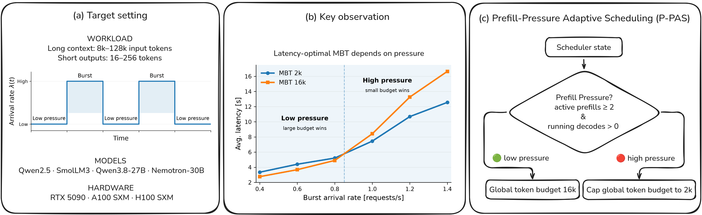

# P-PAS: Prefill-Pressure Adaptive Scheduling for Long-Context LLM Serving

Implementation and experimental artifacts for the
[P-PAS paper](https://arxiv.org/abs/2608.15171).




Long-context LLM applications such as retrieval-augmented generation (RAG)
and agentic systems often process tens of thousands of input tokens to produce
short outputs, making end-to-end request latency an important serving
objective. We show that the maximum number of batched tokens (MBT), which
controls the token scheduling budget in vLLM, has a scheduling-pressure-
dependent effect on latency. Larger token budgets can reduce latency under low
scheduling pressure, while smaller budgets become preferable under higher
pressure. Consequently, no single static MBT performs best across load
regimes.

We introduce Prefill-Pressure Adaptive Scheduling (P-PAS), a lightweight
policy that dynamically adapts the global scheduling budget using concurrent
prefill and decode state. P-PAS retains a large token budget under low pressure
and switches to a smaller budget when multiple prefills compete with active
decoding. Across models, workload configurations, and GPUs, P-PAS maintains
low end-to-end latency across changing load regimes. Kernel-level profiling
shows that the crossover arises from a trade-off between large-chunk prefill
efficiency and prefill–decode interference.

We further extend the pressure signal to heterogeneous request shapes with
P-PAS+. On mixed-shape workloads using Qwen3.8-27B and
Nemotron-3.5-Lightning-30B-A3B, P-PAS+ reduces mean end-to-end latency by
3.0–3.1% relative to the best tested static token budget. Across exactly
matched logical requests, 91.2% of Qwen requests and 88.5% of Nemotron
requests complete faster with P-PAS+.

## P-PAS and P-PAS+

P-PAS switches between two calibrated scheduling budgets:

```text
B_max = large token budget
B_cap = constrained token budget
```

The P-PAS pressure condition is:

```text
active prefills >= 2 AND running decodes > 0
```

Under pressure, the scheduler uses `B_cap`; otherwise it uses `B_max`.

P-PAS+ preserves this condition and additionally detects the case where one
large running prefill overlaps with multiple active decodes:

```text
original P-PAS pressure
OR
(
    running prefills == 1
    AND running decodes >= 2
    AND remaining running prefill tokens >= T_large
)
```

The implementation modifies only the scheduler's global token budget.

The budget endpoints are deployment-specific and are selected with a small
static MBT sweep. The values below reproduce the heterogeneous evaluations in
the paper:

```text
Qwen3.8-27B NVFP4
B_max   = 2048
B_cap   = 768
T_large = 32768

Nemotron-30B NVFP4
B_max   = 16384
B_cap   = 1280
T_large = 65536
```


## Repository Structure

```text
ppas-vllm/
├── benchmark.py
├── run_sweep.py
├── evaluate_results.py
├── scheduler/
│   ├── scheduler_ppas.py
│   ├── ppas_vllm_0.22.1.patch
│   └── ppas_vllm_0.27.1.patch
├── results/
│   ├── vllm_0.22.1/
│   │   ├── RTX5090/
│   │   ├── A100/
│   │   ├── H100/
│   │   ├── nsys_systems/
│   │   └── nsys_compute/
│   └── vllm_0.27.1/
│       ├── qwen/
│       └── nemotron/
├── figures/
├── LICENSE
└── README.md
```

`results/vllm_0.22.1/` contains the experimental results and NVIDIA Nsight
profiling artifacts produced with vLLM 0.22.1, including the primary P-PAS
evaluation, robustness experiments across models and GPUs, workload-shape
experiments, and the profiling data used in the paper.

`results/vllm_0.27.1/` contains the additional large-model experiments and
heterogeneous P-PAS+ evaluations for Qwen3.8-27B and Nemotron-30B.

`scheduler/` contains version-specific patches for vLLM 0.22.1 and 0.27.1,
together with the current vLLM 0.27.1 modified scheduler implementation.

## Installation

The current P-PAS/P-PAS+ implementation targets **vLLM 0.27.1**. Use this
version to run the current code and the large-model/P-PAS+ evaluations below.
The `v1.0-paper` tag preserves the vLLM 0.22.1 implementation used for the
earlier experiments in the paper.

Create an environment:

```bash
conda create -n ppas-vllm python=3.12 -y
conda activate ppas-vllm
pip install vllm==0.27.1
```

P-PAS modifies:

```text
vllm/v1/core/sched/scheduler.py
```

Apply the vLLM 0.27.1 patch:

```bash
SITE_PACKAGES=$(python -c "import site; print(site.getsitepackages()[0])")
cd "$SITE_PACKAGES"
patch -p1 < /path/to/ppas-vllm/scheduler/ppas_vllm_0.27.1.patch
```

The patched scheduler behaves like the standard vLLM scheduler unless P-PAS
or P-PAS+ is explicitly enabled.

## Running P-PAS+

`run_sweep.py` can run P-PAS+, P-PAS, and static token-budget baselines across
multiple workload conditions and random seeds.

For each workload condition and seed, the same generated request trace is
replayed across scheduler configurations, enabling exact request-level
comparisons.

### Qwen3.8-27B heterogeneous evaluation

```bash
python run_sweep.py \
  --configs ppas_plus_qwen,ppas_qwen,512,768,1024,2048,4096,8192 \
  --seeds 0,1,2,3,4,5,6,7,8,9,10 \
  --models qwen_27b \
  --mixed-workload qwen_heterogeneous \
  --arrival-mode piecewise_poisson \
  --phases \
    20:0.05,10:0.1,20:0.05 \
    20:0.05,10:0.4,20:0.05 \
    20:0.05,20:0.1,20:0.05 \
    20:0.05,20:0.4,20:0.05 \
    20:0.05,40:0.1,20:0.05 \
    20:0.05,40:0.4,20:0.05 \
  --log-file results/vllm_0.27.1/qwen/ppas_heterogeneous_qwen.txt \
  --max-num-seqs 20
```

The workload samples uniformly from:

```text
Prompt tokens: 8192, 16384, 32768, 65536
Output tokens: 16, 32, 64, 128, 256
```

Evaluate the results with:

```bash
python evaluate_results.py \
  --input results/vllm_0.27.1/qwen/ppas_heterogeneous_qwen.txt
```

### Nemotron heterogeneous evaluation

```bash
python run_sweep.py \
  --configs ppas_plus_nemotron,ppas_nemotron,1024,1280,2048,4096,8192,16384 \
  --seeds 0,1,2,3,4,5,6,7,8,9,10 \
  --models nemotron_30b \
  --mixed-workload nemotron_heterogeneous \
  --arrival-mode piecewise_poisson \
  --phases \
    20:0.1,10:0.2,20:0.1 \
    20:0.1,10:0.8,20:0.1 \
    20:0.1,20:0.2,20:0.1 \
    20:0.1,20:0.8,20:0.1 \
    20:0.1,40:0.2,20:0.1 \
    20:0.1,40:0.8,20:0.1 \
  --log-file results/vllm_0.27.1/nemotron/ppas_heterogeneous_nemotron.txt
```

The workload samples uniformly from:

```text
Prompt tokens: 16384, 32768, 65536, 131072
Output tokens: 16, 32, 64, 128, 256
```

Evaluate the results with:

```bash
python evaluate_results.py \
  --input results/vllm_0.27.1/nemotron/ppas_heterogeneous_nemotron.txt
``` 
  
See all available benchmark options with:

```bash
python run_sweep.py --help
```

> **Benchmarking note:** For stable latency measurements, run the benchmark on
> an otherwise idle GPU. GPU-accelerated desktop or browser activity can
> noticeably affect latency measurements when the benchmark GPU also drives
> the display.

## Reproducibility and Versioning

The revised paper combines two generations of experiments.

The experiments performed with **vLLM 0.22.1** are retained under
`results/vllm_0.22.1/`, including the primary P-PAS evaluation, robustness
experiments, additional workload-shape experiments, and NVIDIA Nsight
profiling artifacts. The corresponding scheduler patch is available as
`scheduler/ppas_vllm_0.22.1.patch`.

The complete repository state corresponding to the original paper is
preserved in the `v1.0-paper` tag, including the exact software environment
and benchmark instructions.

The additional large-model P-PAS experiments and heterogeneous P-PAS+
evaluation use **vLLM 0.27.1**. The current repository contains their
scheduler implementation, benchmark scripts, and result files.

## Citation

If you use P-PAS or this repository in your research, please cite:

```bibtex
@article{samann2026ppas,
  title={P-PAS: Prefill-Pressure Adaptive Scheduling for Long-Context LLM Serving},
  author={S{\"a}mann, Timo},
  journal={arXiv preprint arXiv:2608.15171},
  year={2026}
}
```

## License

This repository is licensed under the Apache License 2.0. See `LICENSE` for
details.
